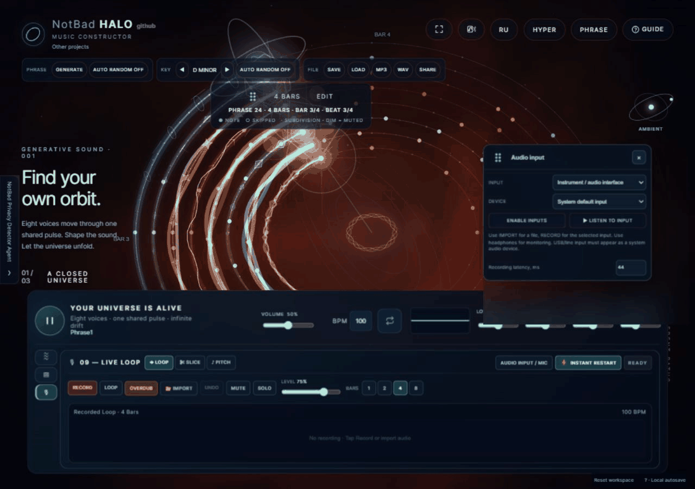

<div align="center">

# NotBad HALO

### Compose worlds, not timelines.

Eight voices. One shared pulse. A universe you can play.

**[Open HALO ↗](https://teutonick.github.io/NotBad-Halo-Music/)** · **[Русская версия](README.ru.md)** · [Explore the engine](docs/engine-capabilities.md)


*Complex to look at. Simple to touch. Harmonious to hear.*

</div>

HALO is a browser music and relaxation constructor. Shape a soundscape, find a phrase you love, and let it grow into a composition. No musical training required: start with **Play**, then follow your ears.

## A little universe. A lot underneath.

| | What makes HALO different |
| :--- | :--- |
| **Eight voices with a purpose** | Pulse, accent, percussion, texture, bass, melody, arpeggio and harmony. Each role has its own musical behavior; you choose its sound. |
| **Two sonic worlds** | **AMBIENT:** 30 original procedural patches. **REACTOR:** 32 presets built from 130 locally hosted CC0 recordings — drums, guitar, bass, piano and synth timbres. |
| **Order beneath the drift** | Independent track cycles and phase offsets move around one shared audio clock. A 24-key major/minor harmonic system keeps generation musically connected. |
| **Your phrase becomes a song** | The local arranger develops a first verse into intro, verses, recurring chorus, bridge and outro. The first verse stays intact; repeated choruses share one phrase. |
| **Three ways to see the sound** | Orbit, Bloom and Current in DRIFT; IN TIME follows musical steps; PHRASE traces a 4/8-bar revolution. Three comet FX modes (Classic, Cosmic, Hyper) with radically distinct visual signatures per track. Switch representation while the music continues. |
| **Track 09: Live Loop & Jam** | An optional 9th audio layer synchronized to the transport: record microphone takes with pre-roll, import audio files, loop in 1/2/4/8 bars, trim waveforms, and overdub non-destructively. |
| **Keep what you make** | Edit phrase steps, shape timbres and spatial effects, enable background playback for uninterrupted listening across tabs and apps, save projects, share compact links and export WAV. MP3 is available when the browser provides a compatible native codec. |

**The core generator needs no AI.** Original motifs, ensemble rules and seeded variation run locally. External browser agents such as Codex can also compose and edit through WebMCP Site Tools or the page-context API. HALO creates every sound locally.

## From silence to sound

1. **Press Play.** Headphones recommended.
2. **Generate a phrase.** Explore AMBIENT or REACTOR, then tap voices to bring parts in or out.
3. **Make it yours.** Hold or right-click a voice to shape its sound. Develop a composition, save it or export the audio.

The **GUIDE** inside HALO covers the deeper controls in English and Russian. For an uncluttered view, hide the interface; click anywhere or press Escape to return.

<details>
<summary><strong>A closer look at the workspace</strong></summary>


The animation and screenshot show the real local app. The GIF is silent and uses a forward/reverse loop for a continuous visual preview.

</details>

## Yours, locally

No backend, account, analytics, runtime CDN or mandatory build. Preferences and work are stored in this browser's localStorage; project files and share links let you carry them elsewhere. Audio recorded or imported into Track 09 is stored locally in IndexedDB and never uploaded to any server or included in share links. Sharing uses data in the link, without a cloud project store.

REACTOR recordings load from the site on demand; the full bank is approximately 65.5 MiB. AMBIENT uses original synthesis. [Recording sources and rights](assets/reactor/README.md).

## Bring your guitar

**Plug in. Catch a riff. Launch your own orbit.**

Connect your guitar through an audio interface and let Track 09 join REACTOR’s eight voices. Record a 1, 2, 4 or 8-bar **LOOP**, stack **OVERDUB** layers and undo the last take. Chop a riff into **SLICE** rhythms, or turn one recorded note into a scale-based melody with **PITCH**. Your sound, inside the universe.



*Real HALO capture; silent GIF. Connect via HTTPS or localhost, enable inputs and select your interface. Recordings stay in this browser. The preview shows the interface and visual world, without an active guitar recording.*

## Run it yourself

Open `index.html`, or serve the folder locally:

```powershell
./scripts/preview.ps1
```

Then open `http://127.0.0.1:8766/`. Deploy the same files to **GitHub Pages** — no build step required.

[Project map](PROJECT_MAP.md) · [Engine capabilities](docs/engine-capabilities.md) · [Agent API specification](docs/agent-api-specification.md) · [Changelog](CHANGELOG.md) · [MIT license](LICENSE)

<div align="center">

**Less setup. More atmosphere.**

[Play HALO ↗](https://teutonick.github.io/NotBad-Halo-Music/) · [More by the creator](https://tnick.cc)

</div>


Track 09 processing belongs to each phrase. Independent variations preserve their own edits; Instant Restart restarts all nine voices together. With it off, sample edits apply on the next phrase cycle. Project files retain local audio references, so imported/recorded audio remains available only in the browser that stores it.


Track 09 now offers **LOOP / SLICE / PITCH**. PITCH plays one trimmed sample as a 16-step melody in the phrase key; set its recorded root note first. All three modes accept a file or a selected microphone/USB/line input, with explicit input monitoring. Hardware must appear as a browser audio input; HTTPS/localhost and permission are required. Pitch changes playback speed, with no independent time stretching.


The workspace folds down to its transport from any editor. Track 09 has its own compact view for LOOP, SLICE and PITCH, plus a separate movable INPUT window with drag-adjustable recording latency. These view preferences are saved locally without changing playback.


UI refinement (2026-10-15): frameless window actions share the top-right edge; Track 09 minimization is visible only on its page. LOOP/SLICE/PITCH share 26 px buttons, compact selects and sliders, aligned parameter grids and thin arrow-free scrollbars. PITCH octave and actions share one row. The input button is labeled AUDIO INPUT / MIC (localized). Musical settings and timing are unchanged.

Track 09 UI: RECORD is red; orange OVERDUB sits beside recording/Loop in the primary actions. All range controls use the master-volume/EQ accent style. PITCH recorded root is grouped with melody octave in advanced settings (hidden when minimized). Audio semantics are unchanged.


Audio input fix (2026-10-15): enumerate selectable nonempty device IDs before stopping the permission probe; preserve the exposed list if a browser later hides IDs, and avoid probing again only after a successful permission probe in the current session. Hardware stays released after the probe. Local controller state adds accessReady, lastError {stage,name,constraint}, and fileContext; the input window reports errors and console diagnostics include operation/error codes without device IDs/labels. For repeated file:// permission prompts, use scripts/preview.ps1 and localhost:8766; persistent permission remains browser-controlled. No automatic monitoring or permissions on reload.

The first ENABLE INPUTS action always probes capture permission; a named system default alone is insufficient. Diagnostic console entries are readable JSON strings.


Track 09 SOLO smoothly silences the eight core voices without changing their mute states or levels; disabling SOLO restores them. Offline export honors this gate too. SLICE advanced settings expose TRIM START/END and automatically rebuild slices on trim changes. With Instant Restart off, live playback retains the previous slices until the next phrase cycle; with it on, the new slices apply at the shared phrase restart.


DELETE sits at the right of the recording/import row. SLICE/PITCH expose CYCLE 4/8/16/32 and STEP 1/16, 1/8, 1/4 beside the pattern grid (16 cells; CYCLE 32 repeats them twice). DURATION selects a fraction of natural slice/sample-window playback length, accounting for pitch; PITCH is no longer capped at one step. Rests let notes ring; a new trigger gently chokes the previous voice. PITCH remains bounded by the phrase end in live/offline playback. No slice time stretching is introduced.


### Compose with an external agent

Open HALO in a browser available to Codex and ask: “Compose an original eight-bar New Year jingle with built-in sounds, your own notes, bass, harmony and effects.” A WebMCP-capable agent discovers HALO tools automatically, reads `halo_get_context`, writes a bounded transaction, validates/previews it and applies it to the open score. No model, API key, chat or manual JSON transfer inside HALO.

**AI / Agents** reports native tool registration. Without WebMCP, agents need actual page JavaScript access to `window.HaloSiteTools` or `window.HaloAgentAPI`; read-only DOM access is insufficient. Browser compatibility and agent permissions matter. Playback can require a normal user Play gesture. Project edits autosave locally; the export tool returns a portable project for the agent to save.

Only 4/4, 4/8-bar phrases and fixed orbit order are implemented. Track 09 recordings are not exposed. See [tools and protocol](docs/agent-api-specification.md), [actual verification](docs/regression-webmcp-2026-10-16.md), and the [new WebMCP control project](artifacts/webmcp/new-year-jingle.halo.json). The published site must be updated before public tools become available.
