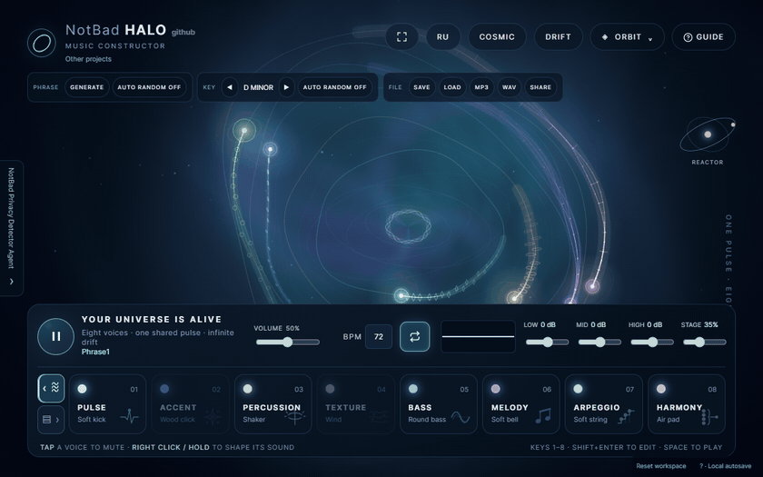
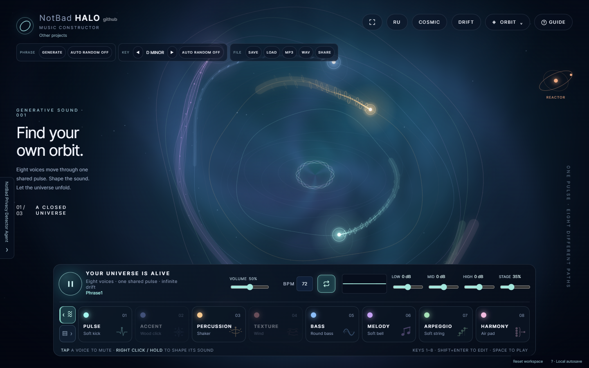

<div align="center">

# NotBad HALO

### Compose worlds, not timelines.

Eight voices. One shared pulse. A universe you can play.

**[Open HALO ↗](https://teutonick.github.io/NotBad-Halo-Music/)** · **[Русская версия](README.ru.md)** · [Explore the engine](docs/engine-capabilities.md)



*Complex to look at. Simple to touch. Harmonious to hear.*

</div>

HALO is a browser music and relaxation constructor. Shape a soundscape, find a phrase you love, and let it grow into a composition. No musical training required: start with **Play**, then follow your ears.

## A little universe. A lot underneath.

| | What makes HALO different |
| :--- | :--- |
| **Eight voices with a purpose** | Pulse, accent, percussion, texture, bass, melody, arpeggio and harmony. Each role has its own musical behavior; you choose its sound. |
| **Two sonic worlds** | **AMBIENT:** 30 original procedural patches. **REACTOR:** 32 presets built from 130 locally hosted CC0 recordings — drums, guitar, bass, piano and synth timbres. |
| **Order beneath the drift** | Independent track cycles and phase offsets move around one shared audio clock. A 24-key major/minor harmonic system keeps generation musically connected. |
| **Your phrase becomes a song** | The local arranger develops a first verse into intro, verses, recurring chorus, bridge and outro. The first verse stays intact; repeated choruses share one phrase. |
| **Three ways to see the sound** | Orbit, Bloom and Current in DRIFT; IN TIME follows musical steps; PHRASE traces a 4/8-bar revolution. Switch representation while the music continues. |
| **Keep what you make** | Edit phrase steps, shape timbres and spatial effects, save projects, share compact links and export WAV. MP3 is available when the browser provides a compatible native codec. |

**Generative, without generative AI.** Original motifs, ensemble rules and seeded variation run locally. No model, prompt, account or API key stands between you and the music.

## From silence to sound

1. **Press Play.** Headphones recommended.
2. **Generate a phrase.** Explore AMBIENT or REACTOR, then tap voices to bring parts in or out.
3. **Make it yours.** Hold or right-click a voice to shape its sound. Develop a composition, save it or export the audio.

The **GUIDE** inside HALO covers the deeper controls in English and Russian. For an uncluttered view, hide the interface; click anywhere or press Escape to return.

<details>
<summary><strong>A closer look at the workspace</strong></summary>



The animation and screenshot show the real local app. The GIF is silent and uses a forward/reverse loop for a continuous visual preview.

</details>

## Yours, locally

No backend, account, analytics, runtime CDN or mandatory build. Preferences and work are stored in this browser's localStorage; project files and share links let you carry them elsewhere. Sharing uses data in the link, without a cloud project store.

REACTOR recordings load from the site on demand; the full bank is approximately 65.5 MiB. AMBIENT uses original synthesis. [Recording sources and rights](assets/reactor/README.md).

## Run it yourself

Open `index.html`, or serve the folder locally:

```powershell
./scripts/preview.ps1
```

Then open `http://127.0.0.1:8766/`. Deploy the same files to **GitHub Pages** — no build step required.

[Project map](PROJECT_MAP.md) · [Engine capabilities](docs/engine-capabilities.md) · [Agent API specification](docs/agent-api-specification.md) · [Changelog](CHANGELOG.md) · [MIT license](LICENSE)

<div align="center">

**Less setup. More atmosphere.**

[Play HALO ↗](https://teutonick.github.io/NotBad-Halo-Music/) · [More by the creator](https://tnick.cc)

</div>
