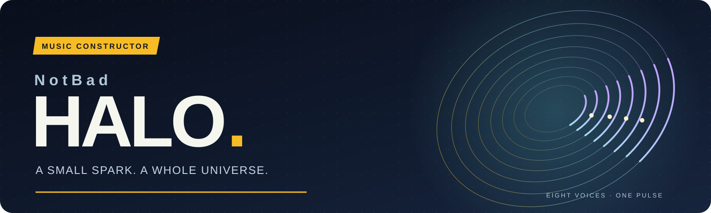
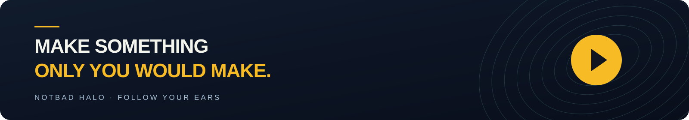

**Complex to look at. Simple to touch. Harmonious to hear.**

[**▶ Enter HALO**](https://teutonick.github.io/NotBad-Halo-Music/) &nbsp; · &nbsp; [Русский](README.ru.md) &nbsp; · &nbsp; [Inside the engine](docs/engine-capabilities.md)

*A browser music constructor for curious ears, happy accidents, and one more loop.*

---

**WATER:** an independent electronic palette of 32 original electronic timbres plus two recorded handpan presets: sub bass, electronic drums, FM percussion, digital textures, arpeggios and chord stabs. First entry starts at 120 BPM; AMBIENT, REACTOR and WATER keep separate workspaces. Narrow, distinct foam/spray wakes remain visible on pause and underwater. All motion/effect modes work. The recorded handpan is verified CC0 FreePats material; no new runtime dependency. Older visual-only water saves keep their music; leave and re-enter WATER for the new palette.

WATER clouds also support opening `index.html` directly from disk: keep the supplied `assets/water/` files together. The local sky companion ships ready to use; no build or browser security changes are required.

The instrument editor’s **Sounds from all worlds** checkbox optionally reveals role-compatible timbres from every world. It defaults off, remembers your choice and preserves selected borrowed sounds when disabled.

**GENERATE now belongs to each world:** AMBIENT keeps its existing musical character. WATER gets its own dance grooves, syncopated hooks and extended chords; REACTOR gets light pop-rock, coordinated bass/guitar/piano and phrase-end fills. Saved music keeps its prior generator until you press GENERATE in that phrase. [Musical rules and compatibility](docs/world-generation.md).

### 01 / INTRO

## STOP MAKING TRACKS. START BUILDING UNIVERSES.

A bass line finds its footing. A melody drifts into view. Somewhere above it, a little percussion starts an argument with the silence. In HALO, eight voices become a living soundscape you can shape by ear — from a quiet place to unwind to a world with its own pulse.

> **Picture this.** It's late. Pick AMBIENT, press Play, and let a few voices breathe. Bring in a bass, leave space around the melody, and find the loop you want to stay inside. The orbits follow your music as it unfolds.

### 02 / THE EXPERIENCE

## NO DAW. NO THEORY. JUST MUSIC.

Start with a phrase. Tap voices in and out, swap instruments, and shape their character while the music keeps moving. AMBIENT brings soft procedural textures; REACTOR adds drums, guitar, bass, piano, and synth timbres. When a phrase clicks, **Build Composition** gives it room to become a song.

> **Try a little mischief.** Let the melody play alone. Bring the percussion back, change its sound, then add harmony. The same phrase suddenly feels different. Keep the version you like, build the arrangement, and give the chorus another listen.

### 03 / LIVE JAM

## 8 VIRTUAL MUSICIANS. YOU'RE THE NINTH.

**Bring your guitar. Or your voice. Or that strange sound you recorded yesterday.**

Track 09 makes room for you alongside the eight core voices. Connect an audio interface or import a sample: catch a riff in **LOOP**, stack another take with **OVERDUB**, cut it into a rhythm with **SLICE**, or turn a recorded note into a melody with **PITCH**.

> **Your band is already waiting.** Set up a groove in REACTOR, record four bars of guitar, and layer a second idea over the first. Or drop in a sound from outside the musical world and slice it into the beat. Now the orbit has something unmistakably yours in it.

The Track 09 preview shows the real interface without an active guitar recording. Audio input requires HTTPS or localhost, browser permission, and a device exposed as an audio input.

### 04 / AI

## YOUR AI. YOUR BAND.

Have a musical idea that's easier to describe than to play? Give it to your AI agent. Through **File Bridge** or **WebMCP**, an external agent can write phrases and arrangements for HALO. Review the result, bring it into your session, and keep shaping it with the same controls. HALO's own generator also works locally whenever you want to explore on your own.

> **Give the band a brief.** “Write an eight-bar pirate chorus with a rolling bass, a bold melody, and room for the drums. Make it feel like the crew is finally coming home.” Let the agent compose, review its submission in HALO, then change a sound or rearrange the sections until it feels like your song.

### 05 / FINALE

## NO INSTALL. JUST PLAY.

Open the browser. Press Play. Follow the idea.

Your session stays in this browser; project files let you carry the arrangement elsewhere, and WAV export lets you take the music with you. Track 09 recordings stay in the browser that holds them. No account or backend stands between you and the first note.

### Your next idea is one Play away.

[**▶ PLAY NOTBAD HALO**](https://teutonick.github.io/NotBad-Halo-Music/)

[Project map](PROJECT_MAP.md) &nbsp; / &nbsp; [Engine](docs/engine-capabilities.md) &nbsp; / &nbsp; [Agent API](docs/agent-api-specification.md) &nbsp; / &nbsp; [MIT license](LICENSE)

**NotBad HALO · [teutonick.github.io/NotBad-Halo-Music](https://teutonick.github.io/NotBad-Halo-Music/)**

