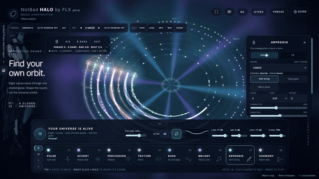
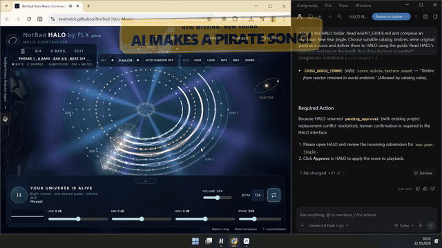
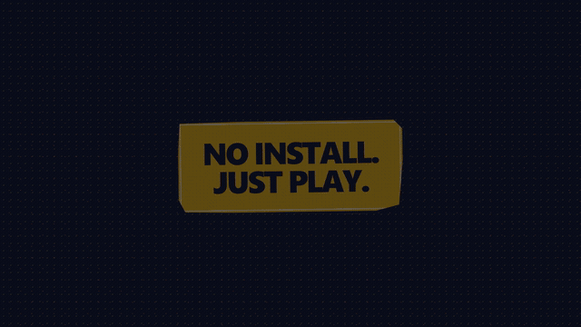

# NotBad HALO

**Музыкальная вселенная, в которой можно играть.**

[Открыть HALO ↗](https://teutonick.github.io/NotBad-Halo-Music/) · [English](README.md)

<strong><small>INTRO</small></strong>

## STOP MAKING TRACKS. START BUILDING UNIVERSES.

Восемь голосов звучат в общем ритме. Начни с одного импульса, меняй звучание на слух и открывай собственную вселенную.

<strong><small>THE EXPERIENCE</small></strong>

## NO DAW. NO THEORY. JUST MUSIC.

Включай и выключай голоса, меняй инструменты и слушай, как преображается вся композиция.

<strong><small>LIVE JAM</small></strong>

## 8 VIRTUAL MUSICIANS. YOU'RE THE NINTH. Bring your guitar.

Подключи гитару через аудиоинтерфейс. Записывай луп, добавляй овердуб, нарезай рифф или превращай ноту в мелодию. GIF без звука показывает настоящий интерфейс; активной записи гитары в нём нет.

<strong><small>AI</small></strong>

## YOUR AI. YOUR BAND.

Дай ИИ-агенту музыкальную задачу, проверь результат в HALO и развей фразы в полноценную композицию.

<strong><small>FINALE</small></strong>

## NO INSTALL. JUST PLAY.

[Карта проекта](PROJECT_MAP.md) · [Возможности движка](docs/engine-capabilities.md) · [Agent API](docs/agent-api-specification.md) · [Лицензия MIT](LICENSE)

**NotBad HALO · [teutonick.github.io/NotBad-Halo-Music](https://teutonick.github.io/NotBad-Halo-Music/)**

